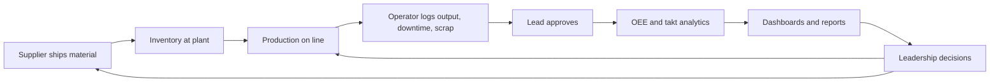

# Smart TAKT Board — High-Level Business Requirements Document (BRD)

| Item | Value |
|---|---|
| Product | Smart TAKT Board (multi-tenant SaaS) |
| Document | High-level BRD |
| Status | Draft v1.0 |
| Sources | Smart TAKT Requirements.docx; DocumentsForGrounding (OEE, TAKT, MES, MPS, inventory, layout references) |

## 1. Business Problem

Manufacturers run plants, lines and machines whose real performance is only partly visible to leadership. Operators record downtime, scrap and output on paper or spreadsheets; the data is late, inconsistent and not tied to a common definition of OEE. Executives therefore cannot see where the process loses time and value, which station is the bottleneck, or whether the line is balanced to takt.

A second blind spot sits upstream. Incoming material from suppliers is tracked by email and phone. Leadership cannot see which parts are at risk of stock-out, which shipments are late, or how supplier performance affects production. The result is expediting cost, idle lines and avoidable delays.

Companies also need to extend visibility to their suppliers (third parties) so that suppliers can capture their own production and shipment data in the same system, while the manufacturer (first party) keeps control over what each party can see.

## 2. Product Vision

A configurable, web-based SaaS platform that:

1. Captures shop-floor operations data (production, downtime, scrap/rejects) at machine and operation level.
2. Converts it into OEE (Availability x Performance x Quality), takt attainment, bottleneck and loss analysis.
3. Presents role-appropriate dashboards and reports, from operator to executive.
4. Connects incoming inventory, purchase orders and supplier shipments to production so shortages and delays are visible early.
5. Is sold to many manufacturing companies (tenants), each configuring terminology, KPI targets, reason codes, custom fields and security to its own needs.

## 3. Business Goals and Objectives

| ID | Goal | Objective |
|---|---|---|
| G1 | Visibility of process performance | One consistent OEE definition across every machine, line and plant, refreshed as logs are entered |
| G2 | Identify bottlenecks and losses | Pareto of scrap and downtime reasons; station-level OEE ranking; line balance (Yamazumi) against takt |
| G3 | Executive decision support | Executive and plant dashboards with KPI status against configurable targets |
| G4 | Supply-chain awareness | Inventory days-of-cover, shortage risk, delayed shipments and supplier scorecards in one place |
| G5 | Extend to suppliers | Suppliers log production and shipments in the same platform with strict visibility isolation |
| G6 | Sellable SaaS | Multi-tenant, configurable without code changes, cloud-hostable |
| G7 | Governance | Role-based CRED permissions, field-level security, record-level visibility and audit trail |

## 4. Stakeholders and Personas

| Persona | Role in the business | Primary need |
|---|---|---|
| Operator | Runs one or more machines | Fast entry of production, downtime, scrap for own machines |
| Lead | Operations lead for an assembly line (shift-level, hands-on) | Review and approve logs for the line; see line activity |
| Supervisor | Supervises several lines, across shifts | Cross-line view, schedule adherence, staffing, escalation |
| Manager | Owns the operations of a part or component | Accountable for OEE of the part's operations |
| Plant Manager / GM | Runs the plant | Budget, quality, staffing, efficiency; plant dashboards |
| Executive | Corporate leadership | Cross-plant KPIs, cost, inventory, delivery risk |
| Quality Engineer | Quality function | Scrap Pareto, rejects log, defect trends |
| Supply Chain Planner | Procurement and materials | Inventory cover, PO and shipment tracking, supplier performance |
| Supplier user (admin / operator) | Third-party supplier staff | Enter own production and shipments; see only own records |
| Tenant Administrator | Customer-side system admin | Configure users, roles, master data, reason codes, targets |
| Platform Operator (vendor) | SaaS provider | Provision tenants, run and support the platform |

## 5. Scope

### 5.1 In scope (Release 1)

- Multi-tenant platform with tenant onboarding and configuration (terminology, KPI targets, reason codes, shifts, custom fields).
- Organizations (internal and supplier), sites, lines, machines/workcenters, parts, BOM, operations (routing), jobs.
- Shop-floor capture: production logs with downtime and scrap events; submit and approve workflow.
- Analytics: OEE, availability, performance, quality, output vs plan, scrap rate, downtime and loss breakdown, bottleneck identification, trend.
- Reports: Quality report (Rejected Parts Pareto and Rejects Log), OEE report, downtime Pareto, Line Balance (Yamazumi) with takt line, CSV export.
- Role-aware dashboards: Executive, Plant, Line.
- Supply chain: supplier parts, purchase orders, supplier-entered shipments (ASN), inventory levels, days of cover, shortage risk, supplier scorecard.
- Security: roles, CRED permission matrix, field-level security, record-level scope, audit log.
- Web UI with Salesforce-style top navigation in a restrained blue and grey theme.
- Cloud-ready deployment (stateless container, PostgreSQL via `DATABASE_URL`).

### 5.2 Out of scope (Release 1)

- Direct machine connectivity (PLC, OPC-UA, MQTT) — manual entry only.
- Full MES functions (scheduling optimizer, genealogy, electronic work instructions).
- ERP/WMS transactional integration (planned as API/CSV import in a later phase).
- Staffing/roster management, andon, maintenance management (Phase 2).
- Native mobile apps (responsive web only).
- Financial costing beyond configurable unit cost on parts.

## 6. Success Measures

| Measure | Target |
|---|---|
| Time for an operator to submit a shift log | Under 3 minutes |
| Dashboard load for a 30-day, multi-plant range | Under 3 seconds at demo scale |
| Tenant onboarding without code change | Roles, reason codes, targets, custom fields all configurable via UI |
| Visibility isolation | Zero cross-tenant and zero cross-supplier data exposure in security tests |
| Adoption | Leadership reviews dashboards in the daily tier meeting |
| Business outcome (customer-side) | Measurable OEE improvement and reduced expedited shipments after deployment |

## 7. Assumptions

- Each tenant has one internal organization and zero or more supplier organizations.
- OEE is calculated from operator-entered logs; planned time per shift is known (shift minus planned breaks).
- For paced lines the ideal cycle time equals takt; for non-paced machines it equals the operation cycle time.
- Suppliers accept entering data in a shared platform under a contractual data-sharing agreement.
- Customers provide master data (plants, lines, machines, parts) at onboarding, by UI or CSV.

## 8. Risks and Mitigations

| Risk | Mitigation |
|---|---|
| Low operator adoption due to data-entry burden | Minimal-field entry form, defaults from operation and shift, large-touch UI |
| Inconsistent OEE definitions across customers | Single standard formula, documented; reason codes flag planned vs unplanned |
| Data leakage between tenants or suppliers | `tenant_id` on every row, server-enforced scope, security tests, audit log |
| Poor data quality | Lead approval step, validation, edit trail |
| Over-configurability slows delivery | Fixed configuration points (terminology, custom fields, targets, reason codes, roles) |
| Supplier reluctance | Suppliers see only own records; data-sharing is explicit |
| Scaling of analytics on a shared schema | Indexed log tables, reporting view, option to add materialized views or read replicas |

## 9. Phasing

| Phase | Content |
|---|---|
| Release 1 (MVP) | Everything in section 5.1 |
| Phase 2 | Staffing/roster, andon and escalation notifications, maintenance (MTBF/MTTR, work orders), SSO (OIDC/SAML), CSV/API import, scheduled report emails |
| Phase 3 | IoT/OPC-UA/MQTT machine connectors for automatic counts and states, predictive analytics, supplier quality (PPM, NCR), ERP connectors, mobile app |

## 10. Business Process Overview

