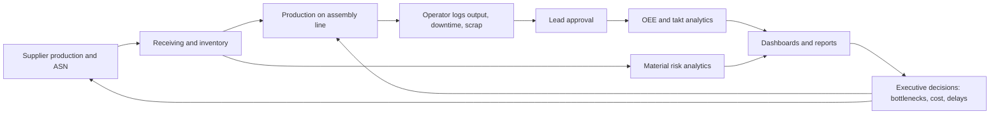
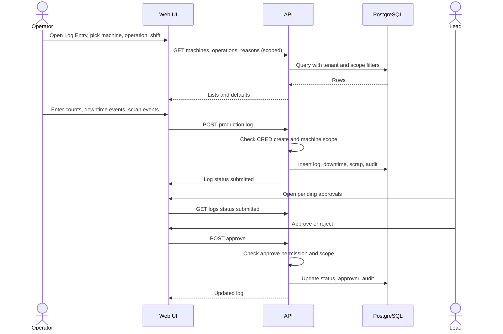
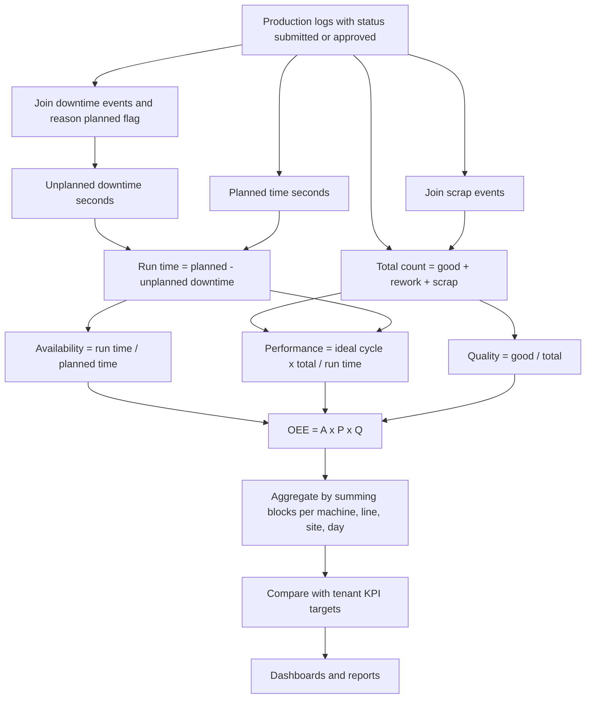
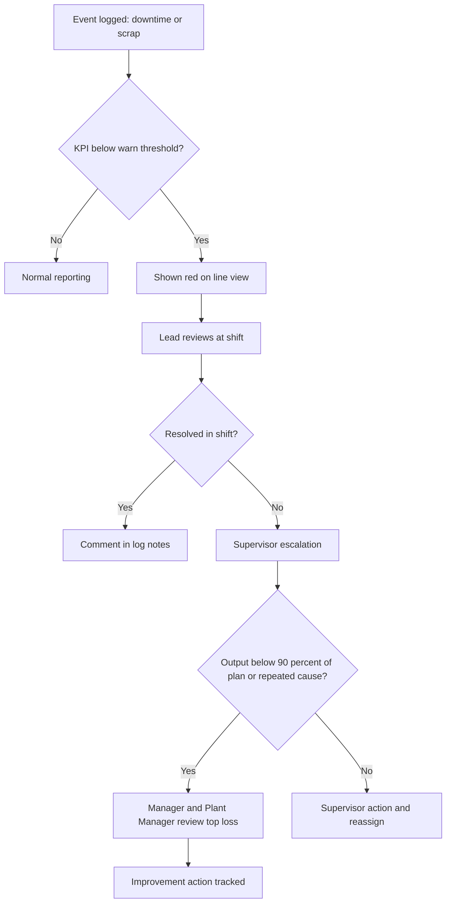
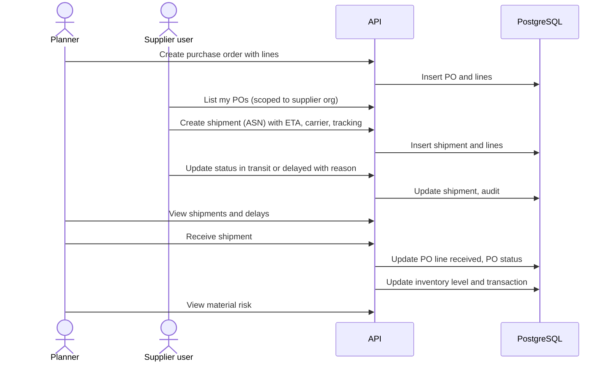
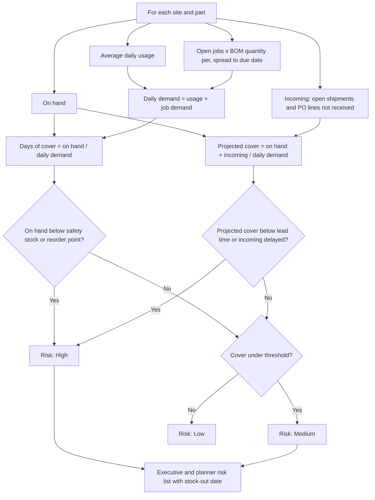
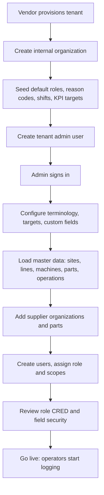
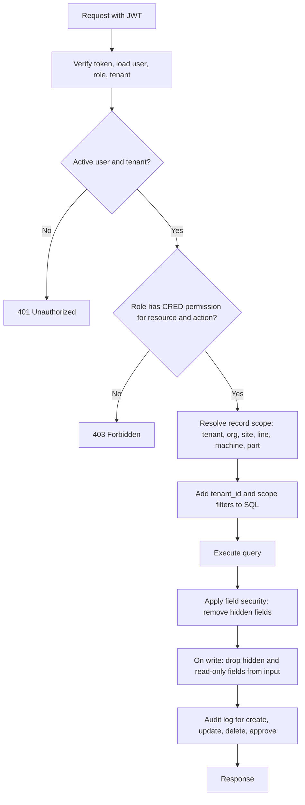
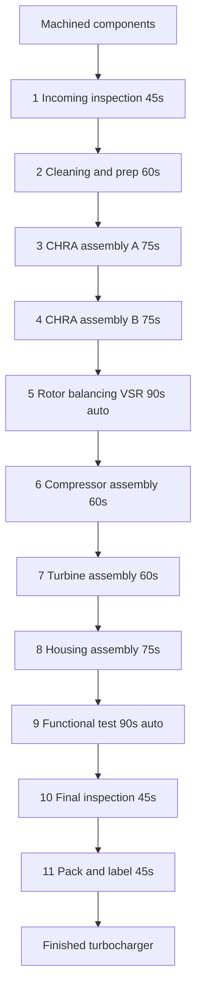

# Smart TAKT Board — Process Diagrams

All diagrams use Mermaid and render on GitHub and most Markdown viewers.

## 1. End-to-End Value Flow

## 2. Shop-Floor Log Capture and Approval

## 3. OEE Calculation Flow

## 4. Downtime and Scrap Escalation

Manual in Release 1 (dashboards and review); automated notification is Phase 2 (andon).

## 5. Supplier PO, Shipment, Receipt and Inventory

## 6. Inventory Risk Logic

## 7. Tenant Onboarding and Configuration

## 8. Authorization Decision Flow

## 9. Turbocharger Assembly Line (from the requirements document)

Cycle times (seconds) per station; line takt about 90 s; bottlenecks are balancing and functional test.

Operator assignment used for the Yamazumi view: Operator A covers stations 1-3, Operator B stations 4-6, Operator C stations 7, 8, 10 and 11; stations 5 and 9 are automated (only load/unload counts as operator work).
