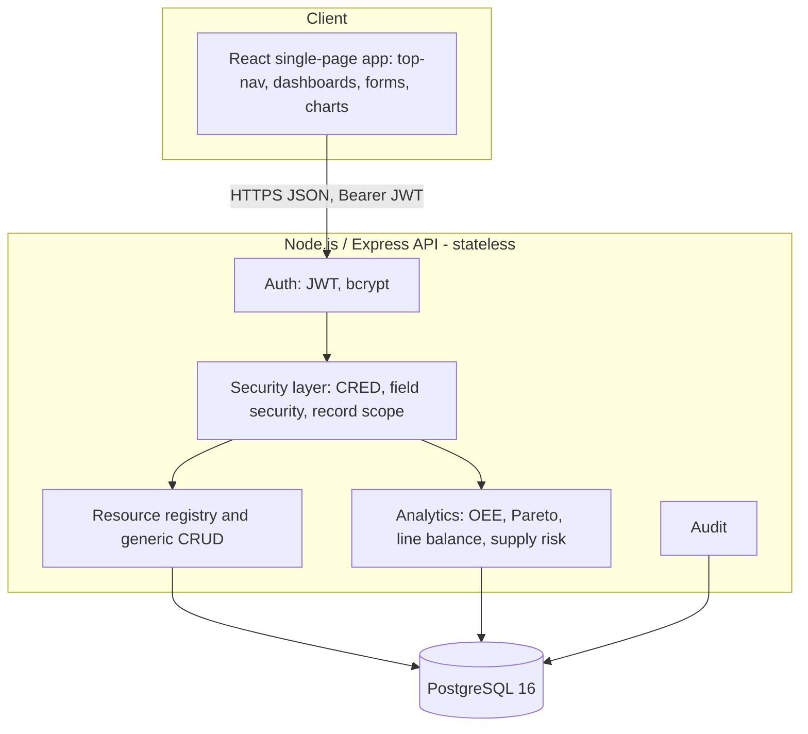
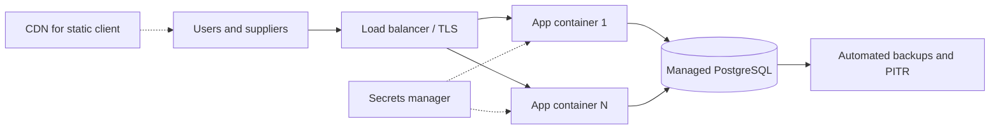
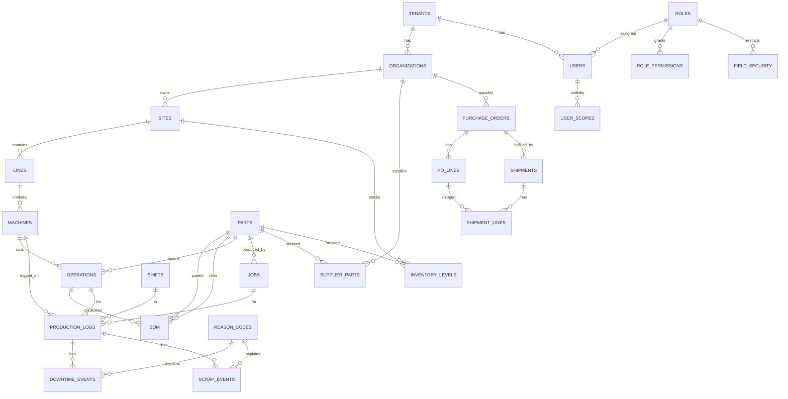

# Smart TAKT Board — Design Document

## 1. Purpose

This document describes the architecture and design of Smart TAKT Board, a multi-tenant SaaS product that captures shop-floor OEE data and supply-chain data and presents dashboards and reports to leadership. It complements the BRD, functional requirements, user stories and process diagrams.

## 2. Architecture

### 2.1 Logical architecture

Layers:

1. Presentation: React 19 SPA built with Vite, React Router, Recharts, lucide icons. Served as static files (by the API process or a CDN).
2. API: Express 5, JSON over HTTPS. Middleware: helmet, CORS, compression, rate limiting, JWT authentication.
3. Domain services: a resource registry describes each entity (table, fields, permission resource, scope strategy); a generic CRUD router applies permission, scope and field security; analytics endpoints run aggregate SQL.
4. Data: PostgreSQL with a shared schema; one reporting view (`v_log_metrics`) exposes OEE building blocks per production log.

### 2.2 Deployment architecture

| Environment | Topology |
|---|---|
| Local | Node API + Vite dev server + local PostgreSQL 16 (Homebrew) |
| Docker | One app container (API serving built client) + PostgreSQL container via docker-compose |
| AWS | ALB, ECS Fargate service (app container), RDS PostgreSQL Multi-AZ, Secrets Manager, CloudFront + S3 optional for static client, CloudWatch logs |
| Azure | Front Door/App Gateway, App Service for Containers or Container Apps, Azure Database for PostgreSQL Flexible Server, Key Vault, Application Insights |
| GCP | HTTPS Load Balancer, Cloud Run, Cloud SQL for PostgreSQL, Secret Manager, Cloud Logging |

The application is stateless: no local file storage and no in-process sessions (JWT). Configuration comes only from environment variables (`DATABASE_URL`, `JWT_SECRET`, `PORT`, `NODE_ENV`, `PGSSL`). The `/api/health` endpoint supports load-balancer probes.

## 3. Multi-Tenancy Model

- Shared database, shared schema, discriminator column `tenant_id` on every business table.
- The tenant is taken from the signed JWT, never from client input. Every query includes `tenant_id = $1`.
- Login uses company code (tenants.slug) + email; email is unique per tenant.
- Tenant-level configuration lives in `tenants.settings` (JSON), `kpi_targets`, `reason_codes`, `shifts`, `custom_fields`, `roles`.
- Hierarchy inside a tenant: organization (internal or supplier) -> site -> line -> machine. Denormalised `org_id`, `site_id`, `line_id` on lower tables make scope filtering cheap.
- Scale-out options: add Postgres Row Level Security as defence in depth; partition large log tables by date; move very large tenants to dedicated databases (schema-per-tenant or database-per-tenant) without changing the API.

## 4. Data Model

### 4.1 Summary

| Group | Tables |
|---|---|
| Tenancy and configuration | tenants, organizations, custom_fields, kpi_targets, reason_codes, shifts |
| Security | users, roles, role_permissions, field_security, user_scopes, audit_log |
| Plant hierarchy | sites, lines, machines |
| Product structure | parts, bom (with optional `operation_id`: the routing step that consumes the component), operations, jobs |
| Shop floor | production_logs, downtime_events, scrap_events |
| Supply chain | supplier_parts, purchase_orders, po_lines, shipments, shipment_lines, inventory_levels, inventory_transactions |
| Reporting | view `v_log_metrics` |

### 4.2 ER diagram (core entities)

### 4.3 Key design choices

- A production log is one machine, one operation, one shift; downtime and scrap are child events so every loss is attributable to a reason.
- Scrap quantity is derived from `scrap_events`, not stored twice, so there is a single source of truth.
- The BOM is multi-level: a part with components is a made part (finished or subassembly); `bom.operation_id` records which routing step of the parent adds each component, so assembly steps visibly add parts. Steps with no link default to the first step.
- Analytics only include logs with status `submitted` or `approved`.
- `custom` JSONB columns hold tenant-defined fields without schema changes.
- Reason codes carry a `planned` flag so planned stops do not reduce availability.

## 5. Security Design

Three independent, stacked layers, all enforced on the server:

1. **Feature and object permission (CRED).** `role_permissions(role, resource)` with create, read, edit, delete and approve. Navigation, routes and API endpoints map to resources (for example `dashboard.executive`, `production_logs`, `purchase_orders`, `users`).
2. **Field-level security.** `field_security(role, resource, field, access)` where access is hidden or read. Hidden fields are stripped from responses and ignored in writes; read fields are ignored in writes. Seeded example: cost fields on parts and PO lines.
3. **Record-level scope.** `user_scopes` of type tenant, org, site, line, machine or part. At request time scopes are resolved to the closure of visible org, site, line and machine ids; queries filter with `= ANY(...)`. The part scope resolves to machines having operations on that part. Supplier users are scoped to their organization and see parts through `supplier_parts`.

Additional controls: bcrypt password hashing, JWT with expiry, helmet security headers, rate limiting on login, parameterised SQL only, allow-list of columns from the resource registry for inserts and updates, audit log on mutations. Roadmap: OIDC/SAML SSO, MFA, Postgres RLS, secrets rotation.

Authorization decision order: authenticate -> role permission -> scope filter -> execute -> field filter -> audit.

## 6. OEE and TAKT Formulas

Definitions per production log, then summed for any aggregation level:

- Planned time `PT` = shift length - planned breaks (seconds).
- Unplanned downtime `DT` = sum of downtime events whose reason is not planned.
- Run time `RT` = PT - DT.
- Total count `TC` = good + rework + scrap.
- Availability `A` = RT / PT.
- Performance `P` = (ideal cycle x TC) / RT.
- Quality `Q` = good / TC.
- OEE = A x P x Q = (ideal cycle x good) / PT.
- Aggregation: sum `PT`, `RT`, `ideal cycle x TC`, `good`, `TC` across logs, then compute ratios. Percentages are never averaged.
- Takt time = available production time / customer demand. Example: 28,800 s shift at 320 units demand gives 90 s.
- Ideal cycle: the operation cycle time; on lines flagged `paced`, the line takt where the station is held to the line rhythm, so non-bottleneck stations do not show artificially low performance.
- Output vs plan = actual total / (PT / ideal cycle).
- Loss breakdown (seconds): downtime loss = DT; speed loss = RT - ideal cycle x TC; quality loss = ideal cycle x (TC - good); fully productive time = ideal cycle x good.
- Worked example from the requirements: A 86%, P 95%, Q 95% gives OEE of about 78%; 320 ideal units per shift becomes about 250.
- Yamazumi: for each operator group sum `manual_time_sec` of its operations, stack by operation, draw takt line; overload = total - takt. Automated time is excluded from operator load; only load/unload counts. Bottleneck station = longest cycle time.

## 7. API Design Summary

REST over JSON, prefix `/api`, `Authorization: Bearer <jwt>`.

| Area | Endpoints (representative) |
|---|---|
| Auth | `POST /api/auth/login`, `GET /api/auth/me` (user, permissions, scope summary, tenant config) |
| Health | `GET /api/health` |
| Generic CRUD | `GET/POST /api/<resource>`, `GET/PUT/DELETE /api/<resource>/:id` for sites, lines, machines, parts, operations, jobs, organizations, purchase orders, shipments, inventory, reason codes, shifts, users, roles |
| Shop floor | `/api/production-logs` (with nested downtime and scrap), `POST /api/production-logs/:id/approve` and `/reject` |
| Analytics | summary, trend, machines, downtime Pareto, scrap Pareto, rejects log, sites comparison, losses, line balance |
| Lifecycle | `GET /api/parts/:id/lifecycle` (nested BOM, routing, stock, inbound, jobs, 30-day OEE and scrap, where-used), `PUT/DELETE /api/parts/:id/bom/:childId` (internal users with edit on parts; rejects cycles and steps of another part) |
| Supply chain | inventory with days of cover, material risk, shipments, supplier scorecard |
| Admin | roles with permissions and field security, user scopes, custom fields, KPI targets, audit log |

Conventions: filters by query string (`from`, `to`, `siteId`, `lineId`, `machineId`); errors as `{ error: message }` with 400/401/403/404; list responses are arrays; dates ISO 8601.

## 8. Configurability Design

| Configuration point | Mechanism |
|---|---|
| Terminology | `tenants.settings.labels` map (e.g. line -> Cell) applied by the UI label helper |
| Modules | `tenants.settings.modules` flags |
| KPI targets and thresholds | `kpi_targets` (target, warn, direction) drive status colours |
| Reason codes | `reason_codes` for scrap and downtime, with category and planned flag |
| Shifts | `shifts` with planned break minutes |
| Custom fields | `custom_fields` definitions rendered into forms; stored in `custom` JSONB |
| Roles and permissions | `roles`, `role_permissions`, `field_security`, `user_scopes` editable in UI |
| Branding (roadmap) | `tenants.settings.branding` for logo and accent colour |

Default role set seeded per tenant: Tenant Admin, Executive, Plant Manager, Manager, Supervisor, Lead, Operator, Quality Engineer, Supply Chain Planner, Supplier Admin, Supplier Operator.

## 9. UI/UX Principles

- Salesforce-like layout: global header (logo, search, user menu) over a tab bar with dropdown menus; content on a light grey canvas with white cards.
- Restrained blue and grey palette; muted green, amber and red used only for status; no gradients or saturated colours.
- Navigation derived from permissions; unauthorised items never render.
- Dashboards: KPI tiles with target comparison, trend charts, Pareto, Yamazumi, tables with sort and CSV export.
- Forms: minimal fields, defaults from operation and shift, touch-friendly controls, inline validation.
- Accessibility: keyboard navigable, contrast compliant, status conveyed by text/icon as well as colour.

## 10. Observability, Backup and DR

- Logging: structured request logs with request id; error logging to stdout for the platform collector (CloudWatch, Azure Monitor, Cloud Logging).
- Health: `/api/health` checks database connectivity; separate readiness vs liveness when orchestrated.
- Metrics: request latency and error rate from the load balancer; database metrics from the managed service; optional Prometheus endpoint.
- Backup: managed automated daily backups with point-in-time recovery; weekly restore test; retention 14-35 days.
- DR: Multi-AZ database; cross-region read replica or snapshot copy for regional failover; infrastructure defined as code; RPO under 15 minutes, RTO under 4 hours.

## 11. Scalability

- Stateless app tier scales horizontally; connection pooling via `pg` Pool and, at scale, PgBouncer or the cloud proxy.
- Indexes on `(machine_id, log_date)` and `(tenant_id, log_date)`; analytics use set-based SQL.
- Growth path: materialised daily rollups per machine, table partitioning by month, read replica for reporting, queueing for heavy exports.

## 12. Roadmap

| Phase | Items |
|---|---|
| R1 (MVP) | Capture, OEE analytics, Quality Pareto, Yamazumi, dashboards, supply chain, security, configuration |
| Phase 2 | Staffing, andon with notifications, maintenance (MTBF/MTTR), SSO/MFA, CSV import, scheduled reports, SQDCP board, RLS |
| Phase 3 | OPC-UA/MQTT/PLC connectors, predictive analytics, ERP/WMS integration, supplier quality, mobile app, per-tenant branding |
